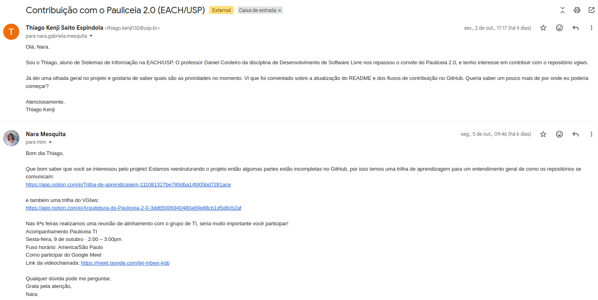

# Um crash no oil.nvim, uma regressão no tmux e o primeiro contato com o Pauliceia

Esta semana dividi o tempo entre duas ferramentas que uso todos os dias e o projeto que deve ocupar o resto da disciplina, o Pauliceia 2.0. No oil.nvim e no tmux, encontrei bugs no meu próprio uso: no primeiro propus uma correção, no segundo abri uma issue. No Pauliceia o trabalho é menos visível, mas talvez seja o mais útil para quem chegar depois de mim.

## oil.nvim: um callback chamado vezes demais

O [oil.nvim](https://github.com/stevearc/oil.nvim) é o plugin que uso no Neovim para navegar no sistema de arquivos e editá-lo como se fosse um buffer de texto. Há algum tempo, apagar um diretório grande, como um `node_modules`, derrubava o meu Neovim com um erro de double free. O problema já estava relatado na issue [#719](https://github.com/stevearc/oil.nvim/issues/719), e decidi que era a oportunidade de tentar contribuir com o projeto mais uma vez.

Eu já tinha aberto um PR no oil, o [#547](https://github.com/stevearc/oil.nvim/pull/547). Uma atualização tinha passado a gerar um erro ao abrir o Neovim com a coluna de tamanho e os arquivos ocultos ativados, e eu adicionei uma verificação para o valor nulo que causava o erro. Na descrição escrevi que não sabia se era a melhor solução. O mantenedor agradeceu, mas corrigiu de outra forma.

Desta vez tentei entender a causa antes de mudar qualquer coisa. O erro vinha de um callback que deveria rodar uma vez e rodava a cada falha. Quando vários subdiretórios falhavam ao mesmo tempo, por exemplo ao estourar o limite de arquivos abertos, cada falha chamava o callback de novo, e cada chamada fechava o mesmo handle de diretório. O que mais me chamou atenção foi que esse código era antigo. Até o PR [#712](https://github.com/stevearc/oil.nvim/pull/712), os erros dos subdiretórios eram ignorados por engano, então o trecho com defeito nunca era executado; quando essa verificação foi corrigida, o double free passou a acontecer.

A mudança que propus é pequena: uma flag compartilhada que impede o callback de rodar mais de uma vez. A explicação completa e os passos para reproduzir estão na descrição do PR [#788](https://github.com/stevearc/oil.nvim/pull/788), que está aberto e aguardando a revisão do mantenedor.

## tmux: uma regressão na versão 3.8

O bug do tmux também apareceu no meu uso diário. Matar a sessão atual pelo `choose-tree` passou a derrubar o servidor inteiro, levando junto todas as outras sessões. Como o problema surgiu depois de uma atualização, minha primeira suspeita foi de que alguma mudança na versão nova exigisse adaptar a minha configuração. Testei alterar algumas opções e procurei issues e PRs que já tratassem do assunto, sem encontrar nada.

Para descartar a configuração, reproduzi o bug num servidor isolado, com as opções `-Ltest` e `-f/dev/null`, que iniciam o tmux sem nenhum arquivo de configuração. O crash continuou, e na versão 3.7c o mesmo procedimento funcionava. Abri então a issue [#5728](https://github.com/tmux/tmux/issues/5728) com os passos de reprodução, o backtrace e os logs. Pelo backtrace, depois que a sessão é destruída o tmux ainda tenta redesenhar a árvore usando um painel que já foi liberado, o que tem relação com o prompt dentro do painel introduzido na 3.8.

Escrever essa issue me mostrou que um relato de bug é mais útil quanto menos trabalho ele deixa para o mantenedor. Quatro comandos e uma sequência de teclas reproduzem o problema; o backtrace e o log indicam onde ele está.

## Pauliceia 2.0: rodar do zero e conferir a documentação

O professor tinha enviado por e-mail, há algumas semanas, o link da organização do [Pauliceia](https://github.com/pauliceia). Entrei em contato com a Nara por e-mail e comecei a explorar os repositórios. Na sexta-feira fizemos uma reunião pelo Google Meet, em que fui adicionado ao quadro do Trello da equipe e fiquei responsável por tentar rodar o projeto do zero na minha máquina, verificando se os READMEs de cada componente estão corretos e se os passos funcionam.

Já consegui rodar o projeto em modo de desenvolvimento. No caminho encontrei instruções erradas, desatualizadas ou incompletas. Um exemplo é o Docker Compose: alguns READMEs o incluem no passo a passo, mas não explicam onde fica o arquivo do compose nem como ele é usado no projeto. Agora estou ajustando os READMEs, começando pelo front-end, para depois enviar à equipe e confirmar se as mudanças fazem sentido.

O e-mail com o convite para a reunião:

Na próxima semana pretendo terminar a revisão dos READMEs e enviar para a equipe avaliar.
